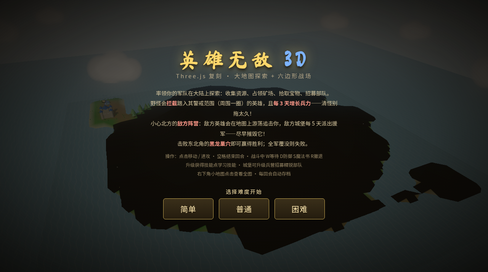
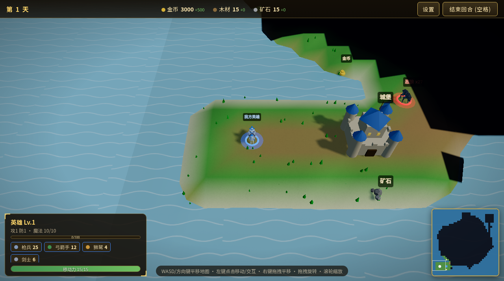
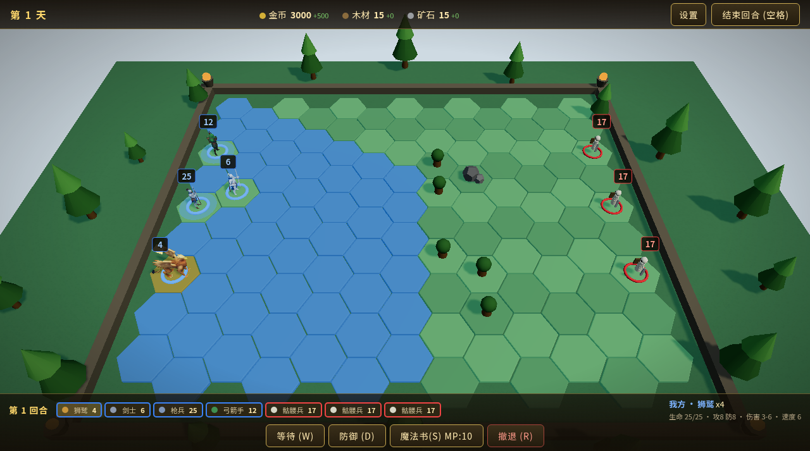

# 英雄无敌 3D（K3 版 H3）

用 Three.js 在浏览器里复刻《英雄无敌3》：异形岛屿大地图探索 + 六边形回合制战场 + 英雄成长 + 敌方阵营 AI。

纯 ES Module、**零构建**，克隆下来起一个静态服务器就能玩。

在线试玩：**https://h3.idiotfan.wang**

| 开始画面 | 大地图 | 战斗 |
|---|---|---|
|  |  |  |

## 快速开始

只需要一个现代浏览器和任意静态 HTTP 服务器，**不需要 `npm install`**。

```bash
git clone https://github.com/idiotFan/h3-replica.git
cd h3-replica
python3 -m http.server 8000      # 或 npm start / npx serve
```

然后打开 <http://localhost:8000>，选「简单 / 普通 / 困难」开始。

> - 不能直接双击 `index.html` 用 `file://` 打开，ES Module 会被浏览器拦下来，必须走 HTTP。
> - Three.js r160 通过 importmap 从 jsDelivr CDN 加载，首次打开需要能访问 `cdn.jsdelivr.net`。
> - 游戏带 Service Worker 缓存，改了代码看不到效果时，硬刷新或清一下站点数据。

## 玩法

率领军队在岛上探索：收集资源、占领矿场、拾取宝物、招募部队，击败东北角的**黑龙巢穴**即获胜，全军覆没则失败。

- **野怪**会拦截走进其周围一圈的英雄，并且每 3 天增长兵力，别拖太久。
- **敌方阵营**在北方：敌方英雄会游荡追击你，敌方城堡定期派出援军。
- **战斗**在六边形战场上回合制进行，有士气、幸运、射手、反击，7 种法术（神箭、治疗、火球、加速、减速、祝福、连环闪电）。
- **英雄成长**：升级获得技能点，8 种技能（进攻、防御、魔力、后勤、智慧、理财、幸运、领导）。
- **三档难度**：初始资源、收入、移动力、野怪和敌方强度都不同。
- 每回合自动存档到浏览器 `localStorage`，有昼夜循环、战争迷雾和小地图。

### 操作

| 场景 | 操作 |
|---|---|
| 大地图 | 左键点击移动 / 交互，`WASD` 或方向键平移，右键拖拽平移，拖拽旋转视角，滚轮缩放，空格结束回合 |
| 战斗 | 点击移动 / 攻击，`W` 等待，`D` 防御，`S` 魔法书，`R` 撤退 |
| 其他 | 右上角「设置」切换画质和静音，右下角小地图点击查看全图 |

## 项目结构

```
index.html          入口（importmap 引入 three）
css/style.css
js/
  main.js           游戏主循环、渲染管线、状态机
  map.js            大地图：岛屿生成、A* 寻路、对象、敌方 AI
  battle.js         六边形战场、回合制、伤害公式、法术、特效
  config.js         单位 / 法术 / 技能 / 宝物定义
  difficulty.js     随难度变化的所有数值
  ui.js minimap.js models.js textures.js utils.js
  assets/           glb 资产清单与分阶段懒加载
art/export/         上线用的 glb 模型（15 兵种 + 2 英雄 + 5 建筑）
art/audio/          BGM 与音效
sw.js manifest.json PWA 支持
scripts/            资产压缩、模型生成、部署等工具脚本（玩游戏用不到）
tests/              基于 Chrome DevTools Protocol 的端到端测试
```

## 开发

工具脚本才需要 Node 依赖：

```bash
npm install
npm run compress:assets -- --format webp   # 从 art/_src 原件压出上线资产
```

- `art/_src/`（Meshy 原始模型）体积大，没有放进仓库，所以重新压缩资产需要你自己的原件。
- `npm run gen:blender` / `gen:glb` 会用旧的 Blender 原语模型**覆盖** `art/export` 里的现有模型，一般不要跑。
- 测试脚本里写死了 macOS 的 Chrome 路径（`/Applications/Google Chrome.app/...`），在 Linux / Windows 上跑要改成本机 Chrome 的路径：

```bash
python3 -m http.server 8000 &
node tests/homm_smoke.mjs "http://localhost:8000/?smoke=map" 40   # 应输出 SMOKE_RESULT: OK
node tests/homm_e2e.mjs
```

更详细的架构、数值表、已知问题和开发记录见 [`HANDOVER.md`](HANDOVER.md)。

## 已知问题

- 部分浏览器里城堡模型可能显示偏暗。
- 模型没有骨骼动画，用的是程序化的颠簸和呼吸动画。
- 目前只有一个玩家英雄，城镇建设只有招募和兵营升级。

## 素材与致谢

- 3D 模型由 [Meshy](https://www.meshy.ai/) AI 生成后压缩。
- 渲染：[three.js](https://threejs.org/)。
- 音效来自 [Kenney](https://kenney.nl/)（CC0）。
- 本项目是个人学习用的同人复刻，《英雄无敌》（Heroes of Might and Magic）商标及原作版权归其权利人所有，与本项目无关。
